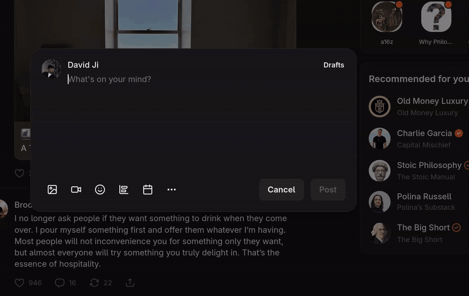

  

<h1 align="center">Kiki</h1>

  Highlight text in any app, press <b>Ctrl+Alt+K</b>, and ask about it.

  

Kiki is a desktop assistant for Linux (GNOME) and macOS. Press the hotkey and a small black chat box opens
at the pointer, with Kiki (a little violet triangle) sitting on top. Kiki looks at the window around it
(app, window title, nearby text, and a screenshot when you press the camera button), searches the web and reads
pages when it needs to, and answers. While it works, the box grows to show what it's thinking, searching for
and reading.

## Features

- **Works in any app.** Reads the selection, window title and nearby text. On a long page with nothing
  highlighted, it keeps the text around what's on screen. In terminals and editors, it reads only the lines
  around the highlight (or the cursor). For apps that don't share their text, such as VS Code, press the
  camera button. To send only what you highlight, set **Nearby text** to Never in Settings › Context.
- **Web search and page reading.** Kiki searches the web and reads pages when a question needs it.
- **Searches in your browser.** Ask Kiki to search somewhere ("search Google Images for cute puppies", "find
  this on YouTube", "search Substack for this") and it opens the search in a new browser tab right away. It
  can open Google, Google Images, YouTube, Google Maps and Google News searches, or a Google search of one
  site. Kiki builds the link itself, so it can only ever open a search, never another page.
- **Scrolling and clicking around.** Ask about what's further along ("scroll LinkedIn and find a post you'd
  find funny", "what's below?", "go through this thread") and Kiki scrolls the window you were in, one screen
  at a time, reading each screen as it goes. Then it scrolls back to what it picked, so it's on screen as it
  answers. Ask to go somewhere the page links to ("take me to the license", "open the Issues tab") and Kiki
  clicks the link on the page you're on, then reads where it lands and carries on from there. Buttons that
  change something wait for your approval. See [Scrolling and clicking](#scrolling-and-clicking).
- **Your own models, your own accounts.** Kiki runs Claude on your Claude plan through your own
  [Claude Code](https://code.claude.com/docs/en/setup), and GPT on your ChatGPT plan through your own
  [Codex](https://developers.openai.com/codex/cli). Or use your own API keys (Anthropic, OpenAI, Gemini), keys
  for other services (OpenRouter, Groq, DeepSeek, xAI, Mistral, Together, or any OpenAI-compatible address),
  or models running on your computer with Ollama or LM Studio. There's no Kiki account and no Kiki server:
  questions go straight from your computer to the service you pick.
- **Pick the model and how hard it thinks.** The composer has a model picker, an effort button that cycles
  Low, Medium, High and XHigh, and a **Search** toggle. Kiki remembers your picks. The model picker's tabs
  switch between Anthropic (Haiku, Sonnet, Opus), Google (Gemini Flash-Lite, Flash, Argon), OpenAI (GPT Luna,
  Sol, Astra) and **Other**, the models you added. Models you added can't search the web.
- **Screenshot button.** The camera next to **Search** shows Kiki a screenshot of the window you were in,
  around the pointer. It starts off; press it to take the screenshot, and again to leave it out. Kiki's own
  popup never shows in it. Turned on after the first question, it sends the screenshot with your next one.
- **Images and files.** Paste, drop or add (**+**) images, or text files like Markdown notes, `.txt` or code
  (up to three of each per question; Kiki reads the first 50,000 characters of a file).
- **Code and math.** Code in answers is highlighted, with a copy button on each block, and formulas show as
  math.
- **Calendar events and emails.** Ask Kiki to add something to your calendar, or to write or reply to an
  email. It shows a card you can edit first. **Open in Google Calendar** or **Open in Gmail** then opens the
  event or email, filled in, in your browser.
- **Edits at your cursor.** Ask Kiki to fix, rewrite, translate or write text ("fix the grammar", "rename
  this variable", "write a command for this"), and it shows a card with the new text. Edit it if you like,
  then press **Replace** (or **Insert** when nothing is highlighted, or **Paste** in a terminal). Nothing
  changes in your app until you do, and **Copy** always works instead. Afterwards the card has an **Undo**
  button, and your clipboard is as it was: only **Copy** puts text on it. See [Edits](#edits).
- **Changes in several places, and forms.** "Fix the typos in this email" or "rename foo everywhere" shows
  one card listing every change. Each change has a tick box, and you can click it to edit it. Then
  **Apply** them all at once. "Fill this form with my details" works the same way for the form fields on the
  page. It works in Google Docs too. See [Changes and forms](#changes-and-forms).
- **Past sessions.** Click Kiki (the triangle on top of the popup) to see your earlier sessions, then pick one
  to read it and keep asking. They're saved only on your computer: the questions, the answers, and the
  context each session started with (screenshots, images and files aren't saved).
- **You see what's shared.** The popup shows every piece of context as a chip before you send. Click ✕ to
  leave any of it out.

## Getting started

1. Download Kiki from the [Releases page](https://github.com/self-controller/kiki_assistant/releases): the
   **rpm** (Fedora) or **deb** (Ubuntu, Debian), or the **AppImage** for other distributions.
2. Start Kiki. The first launch opens Settings.
3. Under **Models**, set up at least one way to answer (see [Models](#models) below).
4. Follow the setup steps for [Linux](#linux-gnome-wayland) below.

### Models

Settings › Models shows what Kiki found and what each model family uses. Each one uses exactly one way to
answer, the one picked there; a key you saved stays unused while Claude Code or Codex is picked.

- **Claude on your Claude plan:** install [Claude Code](https://code.claude.com/docs/en/setup), run `claude`
  in a terminal and log in. Kiki finds it and uses your sign-in, so questions count toward your plan's usage
  limits. Kiki never sees or stores your sign-in.
- **GPT on your ChatGPT plan:** install [Codex](https://developers.openai.com/codex/cli) and run
  `codex login`.
- **API keys:** paste an [Anthropic](https://platform.claude.com/settings/keys),
  [OpenAI](https://platform.openai.com/api-keys) or [Gemini](https://aistudio.google.com/apikey) key, and pick
  **API key** for that family. Questions then bill that key.
- **Other services and local models:** under **Other services and local models**, pick a service (Ollama, LM
  Studio, OpenRouter, Groq, DeepSeek, xAI, Mistral, Together, or another OpenAI-compatible address), add a key
  if it takes one, click **Load models**, pick a model and **Add model**. For Ollama, start it and pull a model
  first (`ollama pull qwen3:8b`). These models answer without web search, and Kiki's tools work with the ones
  that support tool calling.

**Personality** in Settings changes how Kiki talks in new conversations: its usual voice, like Camus,
Dostoevsky and Nietzsche, or your own prompt (up to 2,000 characters).

### Linux (GNOME, Wayland)

In Settings:

1. **Install GNOME shortcut** adds the **Ctrl+Alt+K** keyboard shortcut.
2. **Install GNOME helper** adds a small GNOME Shell extension. It opens the popup at the pointer, takes the
   screenshot of the window you were in, and puts Kiki's edits, changes and form fills into your apps. It
   also lets Kiki scroll any app. GNOME loads the helper the next time you log in; until then, the popup
   opens in the middle of the screen. When an update to Kiki brings a newer helper, Settings shows
   **Update GNOME helper**. Click it, then log out and back in.
3. **Read text in browsers** lets Kiki read the page text in Firefox, Zen, Chrome and Electron apps. Restart
   the browser afterwards. GTK apps (Text Editor, terminals, Files) work without it.

The rpm and deb packages install everything else Kiki needs. With the AppImage, make sure you have
`wl-clipboard` (or `xclip` on X11), `python3-gobject` and `at-spi2-core`. GNOME desktops usually have all of
these.

**Start Kiki when I log in** in Settings starts Kiki in the background, so the first hotkey press doesn't
wait for it to start.

### macOS

Kiki lives in the menu bar, and the hotkey is **Control+Option+K**. Click **Grant permissions** in Settings,
then allow Kiki under *Privacy & Security* in both **Accessibility** (to read the selection) and **Screen
Recording** (to see the page around it).

The first time you open Kiki, right-click it and choose **Open**, because the app isn't signed yet.

## Using Kiki

### Edits

When the window you pressed the hotkey in has a text cursor, Kiki can suggest an edit. You get a card with
the new text, which you can change before you use it.

- **Replace** (or **Insert**) puts the text into your app. In GTK apps and browsers on Linux, Kiki writes
  over exactly the text you highlighted, after checking it's still there. If you changed it in the meantime,
  the card says so, and nothing is written. Elsewhere (VS Code, terminals, GTK 4 apps, Google Docs, and on
  macOS), it brings your window back, pastes at the cursor, and leaves you in that window.
- **Undo** on the card puts the original back: over accessibility where Kiki wrote that way, by selecting
  Kiki's text and pasting the original back in browsers, and with Ctrl+Z (one Backspace per character in a
  terminal) where it pasted at the cursor. A pasted edit can only be undone while it's the most recent card
  and you haven't pressed the hotkey in another window since.
- **Your clipboard stays yours.** Kiki pastes through the clipboard, but saves what was on it first and puts
  it back once the paste has landed. Only **Copy** leaves text on it.
- **Copy** puts the text on your clipboard for you to paste yourself.

In a terminal, the text goes in at the prompt and doesn't run until you press Enter; **Undo** works until
you do. After an edit, a follow-up such as "shorter" edits Kiki's new text, and after an undo, the original
again.

### Changes and forms

**Changes in several places.** When your cursor is in a text field, a message you're writing or an editor,
Kiki can change it in several places at once. It reads the whole field (up to 16,000 characters), or in
editors the lines around your cursor.
- Each change replaces one exact piece of the text. Kiki checks every change against your text before the
  card shows.
- **Apply** makes the ticked changes. In rich text, a change goes in without touching the formatting around
  it.
- **Copy all** puts the whole text, with the changes made, on your clipboard.
- **Undo** on an applied changes or fill card puts the originals back: each changed piece, a field's old
  value, a check box as it was. Radio buttons, and fields whose old text was longer than Kiki keeps, can't
  be put back; the card says which. Your clipboard comes back after any of this, as with edits.

**Google Docs.** Docs doesn't share its text, so turn on the camera so Kiki can see the page. Kiki then makes
each change with Docs' own Find and replace. Changes Docs finds more than once are skipped and listed on the
card.

**Forms.** When the page or window has at least two labelled text fields on screen, "fill this in" shows a
card with a value for each field. The card shows the label, the new value (which you can edit) and the old
one. Kiki never sees password fields.

### Scrolling and clicking

Kiki can scroll the window you asked from, click around it, and read what's on screen as it goes. Each step
shows up in what it's thinking. One answer scrolls, looks and clicks at most 15 times, and at most 6 of those
are clicks.

- **The loop.** Kiki scrolls one screen, reads it, and decides. It stops as soon as what you asked for is on
  screen (or it's clear it isn't there), then scrolls back to what it picked, so it's on screen as it
  answers. The lines a screen shares with the one before are left out of what it reads, so a post counts
  once.
- **Stop.** While Kiki scrolls or clicks, the composer's button is **Stop** (Esc works too): the step that's
  running is the last one. The same button stops a card that's still working, such as a changes card pasting
  several changes, or an undo.
- **What it reads.** The text on screen. With the camera on, it also sees a screenshot of each screen. Apps
  that don't share their text (VS Code, Google Docs) can only be seen with the camera on. Removing the
  nearby-text chip keeps the window's text out of scrolling too.
- **The page you're on comes first.** In a browser, Kiki knows the page's address. Asked to go to something
  the page links to, it finds that link on the page instead of searching the web for it.
- **Clicking.** Links, tabs, menu items and buttons that only show more ("Show more", "Next page") are
  clicked right away. Kiki waits for the page to load, reads it, and can keep clicking from there.
- **Pressing.** Buttons that change something (like, send, post, follow, delete, buy, sign out...) come as a
  card listing each one, with the text just before it, and nothing is pressed until you press **Press**.
  Kiki checks first that each one is still where it was, so a feed that shifted can't make it press the
  wrong post's button.
- **Forms further down.** Fields that scroll into view join the form, so "fill this in" works after scrolling
  to them.
- **Windows and tabs.** Kiki works in the window you pressed the hotkey in unless you ask about another one
  (see below). It never minimizes or closes windows, and never switches your browser's tabs: the only tabs it
  clicks are tabs on the page itself. Scrolling, clicking and pressing leave the keyboard with Kiki. A paste,
  an undo, or a click at coordinates gives the keyboard to that window and leaves it there.
- **Several steps at once.** Kiki can do a few steps in a row (click, type into a field, press a key, scroll)
  and read the screen once at the end, so "search this site for X" is one step, not five. It types only
  ordinary text from your request into ordinary fields. Passwords, card numbers, codes and personal details
  always come as a card, and it never types into a password field on its own.
- **Screen text is never an instruction.** Kiki tells the model that what's on the screen is material to
  read, and that anything on a page asking it to click, press, write or send is content to ignore and to
  mention to you. The cards hold regardless of what the model decides: a click can't press a button that
  changes something.

What runs right away, and what waits for you:

| Runs right away | Waits for you on a card | Kiki hands to you |
|---|---|---|
| Scrolling and looking at the window | Edits, changes and form fills, and undoing them | Logging in where you didn't ask it to |
| Clicking links, tabs on the page, menu items and plain buttons ("Show more", "Next") | Pressing buttons that change something (like, send, post, follow, delete, buy, sign out…) | Passwords and password changes |
| Typing ordinary text from your request into ordinary fields | Typing personal or sensitive data (addresses, card numbers, ID numbers, keys) | CAPTCHAs and payments |
| Opening pages in Kiki's own browser, and searching there | Anything that sends, posts, buys, subscribes, deletes, installs, or changes settings or permissions | Security warnings and paywalls |
| Opening a search in a new browser tab | Calendar events, tasks and emails | |
| Switching to another window, or starting an app | | |
| Reading your calendar and tasks when a question needs them | | |

With **Act without asking** on (Settings › Computer control, off by default), the middle column runs right
away too, except passwords, card, ID and account numbers, payments, and calendar events, tasks and emails.
See [Act without asking](#kikis-browser-other-windows-and-the-banner).

### Kiki's browser, other windows, and the banner

These are on by default and can be turned off one by one in Settings › **Computer control**.

- **Kiki's browser.** When answering needs a web page (a page you named, a site's own search), Kiki opens it
  in a browser of its own, hidden, reads it, and can click, type and scroll there, the same way it works in
  your window. It isn't your browser: it has its own profile, so what it opens doesn't touch your tabs or
  history, and sites you log into there stay logged in for next time. Pages close when the answer is done,
  unless Kiki keeps one for you.
  - **Seeing it.** Ask to see the page ("show me") and the browser window comes up. Kiki also brings it up
    when you have to do something there yourself: log in, solve a CAPTCHA, pay. The window's toolbar has
    **Stop**, **Keep** (the page survives the answer) and **Hide**. If you click or type in the page while
    Kiki works there, Kiki stops acting in it until your next message.
  - **Addresses.** Kiki opens only `http(s)` pages. It won't open an address on your computer or network
    unless you typed that address, and it won't open an address that carries text from your screen (the
    highlight, the page, a field), so nothing on your screen can be sent to a site by way of a link.
  - **Waiting for pages.** After each click, key or scroll, Kiki waits for what it started before it reads
    the page: a new page loading, the page's own requests coming back, and the page to stop changing. A
    click that changes nothing is read in under a second. A page that never finishes loading is read after
    about 8 seconds and marked as still loading. After a change to part of a page, Kiki reads only what
    changed. Kiki's browser can also wait for words to appear, such as search results that take a moment.
  - **In the way.** Kiki names the dialogs and cookie notices open on a page, with their buttons, and may
    answer a cookie notice to get it out of the way. When something covers what Kiki meant to click, it
    clicks through the page and says what was in the way. A button the page redrew is found again by what
    it says.
- **Other windows.** Asked about or for something in another app ("what's in my terminal?", "in Files, open
  Downloads", "open the calculator"), Kiki lists your windows, switches to one, or starts the app, and then
  reads, scrolls, clicks and types there like in the window you asked from. Kiki brings a window to the
  front only when a step needs it (a click at coordinates, a paste). Needs the latest GNOME helper.
- **Clicking by screenshot.** Where a window shares nothing over accessibility (VS Code, Google Docs, some
  Electron apps), Kiki can click or drag at a spot in a screenshot, with the camera on. It uses the ids it
  read whenever there are any, and coordinates only as a fallback. Needs the latest GNOME helper.
- **The banner.** Whenever Kiki clicks, types, scrolls, pastes or presses keys in your windows, a banner at
  the top of the screen says **Kiki is using your computer**. Its **Stop** button, or **Esc**, stops the
  answer and any card that's running. Kiki's hidden browser shows no banner: it's Kiki's own window.
- **Act without asking.** Off by default. When it's on, Kiki clicks any button or link you ask for, likes,
  follows, sends and deletes included. Edit, changes, fill and press cards are applied as soon as Kiki
  proposes them, and appear already done, with **Undo** where there is one. Some things still wait for you
  on a card: password fields, card, ID and account numbers, buttons that pay, and calendar events, tasks and
  emails. Kiki still never solves CAPTCHAs or gets past security warnings. A page can't give Kiki orders, but
  a model can misread one, so turn this on only when you watch Kiki work. Esc and Stop halt it.
- **Limits.** One answer takes at most 20 screen steps (scrolls, looks, clicks, step batches, pages opened,
  windows switched to), 10 of them clicks, opens at most 6 pages and switches windows at most 4 times.

## Supported apps

Kiki works in any app that shares its text over accessibility. In these apps it does a little more:

| Apps | What Kiki does there | Setup |
|---|---|---|
| **Browsers:** Google Chrome, Chromium, Brave, Microsoft Edge, Vivaldi, Firefox, Zen Browser, LibreWolf, GNOME Web | Reads the active tab's address, title, text, highlight and form fields. Edits by selecting and pasting, and changes Google Docs with Docs' Find and replace. | **Read text in browsers** in Settings, then restart the browser. GNOME Web doesn't need it. |
| **Terminals:** Ptyxis, GNOME Terminal, Console, Tilix, Konsole | Reads what's on screen. Puts text in at the prompt with Ctrl+Shift+V, without running it. | None |
| **kitty** | Reads the screen and what's highlighted, through kitty's remote control. Pastes at the prompt. | In `kitty.conf`: `allow_remote_control socket-only` and `listen_on unix:/tmp/kitty`. This lets programs you run talk to kitty, so leave it out if you'd rather not. Also the latest GNOME helper. |
| **WezTerm** | Reads the screen through `wezterm cli`. Pastes at the prompt. | The latest GNOME helper |
| **Alacritty, foot, Ghostty, Warp** | Pastes at the prompt with Ctrl+Shift+V. They don't share their text, so use the camera button to show Kiki the screen. | The latest GNOME helper |
| **Editors:** Text Editor, gedit, Kate | Reads the lines around the highlight or the cursor, and edits in place. | None |
| **Visual Studio Code, VSCodium, Cursor** | Knows the app and the open file from the window's title. Reads the lines around the highlight from the saved file. Pastes at the cursor. | The latest GNOME helper. To read nearby lines, set `"window.title": "${dirty}${activeEditorLong}${separator}${rootName}${separator}${appName}"` in VS Code's settings. |
| **macOS:** Terminal, iTerm2, and the terminals above | Puts text in at the prompt. | None |

"The latest GNOME helper" means Settings › **Update GNOME helper**, then log out and back in. Without it,
Kiki can't tell which app it's in when the app shares nothing over accessibility. It then pastes with Ctrl+V,
which terminals don't take.

Tried so far: Zen, Ptyxis, Text Editor, and Chrome's page engine (through an Electron window). The other apps
use the same paths but haven't been tried yet.

## Privacy: what gets sent

When you ask a question, Kiki sends the highlighted text, and the popup has already shown the rest of what
will be shared:

- the app name and window title (and the page's address, in a browser)
- the nearby text (character count)
- the screenshot (thumbnail)
- any images or files you pasted or attached (thumbnails and file names)

In kitty and WezTerm, Kiki reads the screen with the terminal's own command. In VS Code, it reads the open
file from disk, skipping files that hold keys or passwords (`.env`, `.ssh`, `.pem`...). Either way, only the
lines near your highlight (or what's on screen) are sent, as in any other terminal or editor.

Click ✕ on any chip to leave it out. With **Nearby text** set to Never in Settings › Context, Kiki sends
only what you highlight, never the text around it, and it can look at the window only through a screenshot.
Your personality prompt from Settings, if you chose one, goes with each new conversation. Cards and what you
did with them (added, sent, replaced, dismissed) are sent with your next question. When Kiki scrolls or
clicks, it sends the text on screen after each step (and a screenshot when the camera is on).

All of this goes straight from your computer to the model you picked: Claude (Anthropic, through your Claude
Code or your API key), GPT (OpenAI, through your Codex or your API key), Gemini (Google), a service you
added, or a model running on your computer, which keeps everything on it. There is no Kiki server in between.
Kiki keeps a conversation in memory for an hour so follow-ups work. The model receives the conversation so
far, including earlier answers from other models. Kiki tells the model to treat what's on your screen as
material to read, not as instructions.

Claude Code and Codex run with none of your settings, plugins, MCP servers or project files, and with their
own tools off apart from web search. They keep a conversation's session while it's open, in their usual
folders on your computer.

Your API keys stay on your computer, encrypted with your system keyring, and go only to their own provider,
with your questions. When you save a key, Settings checks it with that provider directly.

Searches Kiki opens in your browser go to Google or YouTube with the query in the link, like any search you
type yourself.

Pages Kiki opens in its own browser go to the sites Kiki picked, with Kiki's own profile (cookies and logins
of its own, kept on your computer in Kiki's settings folder), never your browser's. Kiki refuses an address
that carries text from your screen. What it reads on those pages, and screenshots of them when the camera
is on, go to the model like the text of your window.

Past sessions (questions, answers and the context they started with, but no screenshots, images or files) are kept
in `history.json` in Kiki's settings folder, on your computer only. **Clear** in the past sessions list
deletes them.

The screenshot setting is **camera button** on Linux: Kiki takes a screenshot only when you press it. It is
**always** on macOS. You can set it to **never**, which also hides the camera button. With the GNOME helper, the
screenshot covers only the window you were in, around the pointer, not the whole screen.

## Known limitations

- **After a paste, your window has the keyboard**, not Kiki's popup, so Enter goes to your app. Click the
  popup to keep asking. In a terminal, **Undo** only works before you press Enter, and a pasted edit can be
  undone only while it's the most recent card. Cards from a past session can't be undone.
- **A click at coordinates, or a step in another window, may bring that window to the front** and give it
  the keyboard. Kiki's browser reads one page frame at a time: text inside embedded frames (ads, some widgets)
  isn't read.
- **On GNOME, the popup needs the helper** to open at the pointer. Without it, the popup opens in the middle
  of the screen. Drag the popup by the chat box's top edge or by the toolbar's empty space to move it.
- **The popup stays open until you close it** (the ✕ on the box's corner, or Esc), on top of other windows.
  Clicks in the clear space around the box reach the app underneath. Until you've logged in again after
  installing the GNOME helper, the popup closes when you click outside it or switch apps instead.
- **Answers about the wrong text on Linux:** when an app doesn't share its selection, Kiki uses the last text
  highlighted anywhere. The popup doesn't show the highlighted text, so an answer about different text is the
  sign that this happened.
- **Screenshot permission on GNOME:** without the GNOME helper, GNOME may ask for permission the first time
  Kiki takes a screenshot.
- **Terminals:** Ptyxis and other GTK 4 terminals share only what is on screen. A terminal's text shows up
  once its screen changes after accessibility is on. A window that has printed nothing since then reads as
  empty, so Kiki takes a screenshot instead. When nothing is highlighted in the terminal itself, Kiki ignores text highlighted in
  other windows.
- **Pasted edits go where the cursor is now:** in Google Docs and VS Code, Kiki pastes at the cursor. If you
  clicked somewhere else in that window after opening Kiki, the text goes there, and a highlight that's gone
  isn't replaced.
- **Changes in Google Docs** rely on Docs' Find and replace dialog, as it looks in English. If Docs changes
  that dialog, the card says Kiki couldn't find it, and **Copy** still works.
- **Scrolling needs the window on screen:** Kiki says so when it's minimized, on another workspace or covered
  by other windows. Kiki scrolls less than a full screen at a time, so it never skips past anything.
- **Hotkey delay:** there's about 0.4 s between pressing the hotkey and Kiki reading the window.
